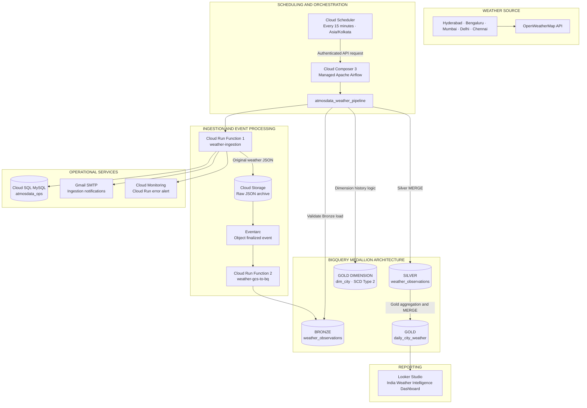
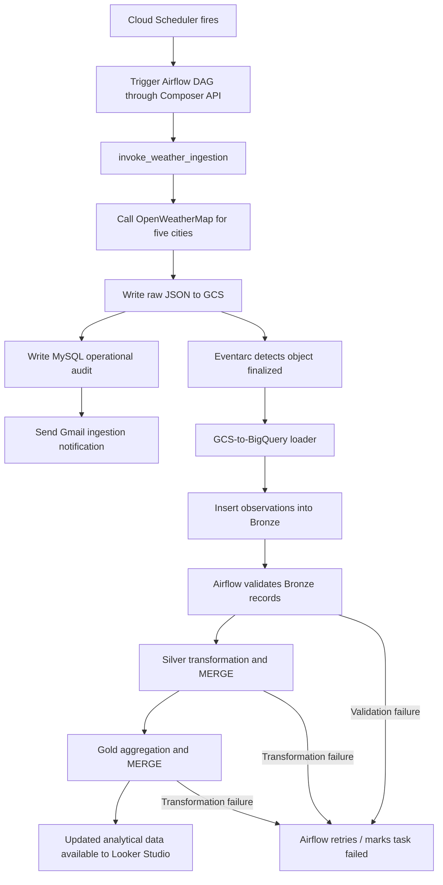
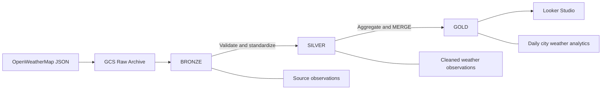
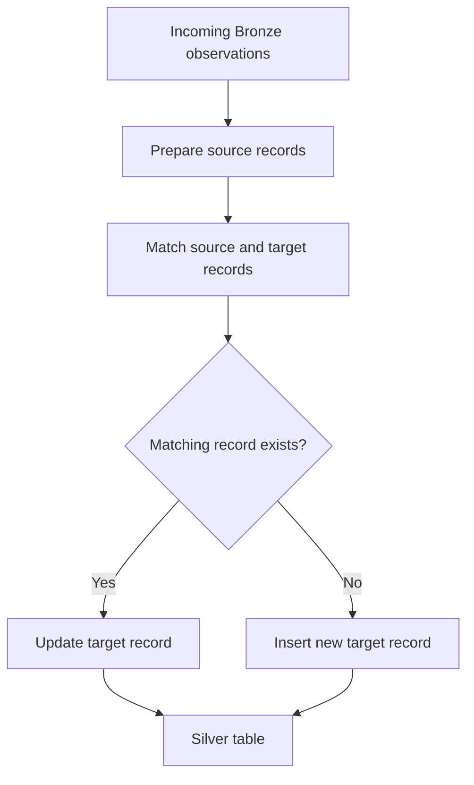
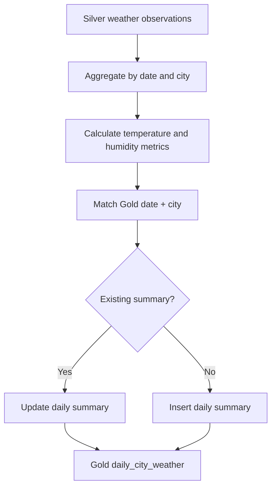
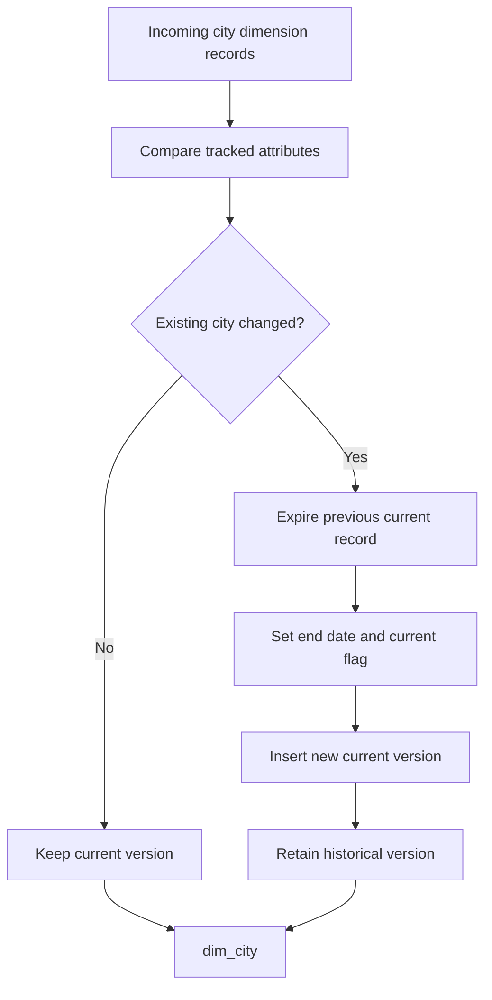
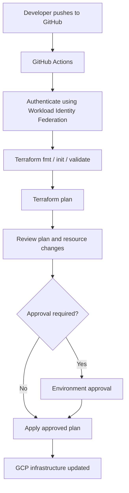

# AtmosData — Real-Time Weather Data Intelligence & Analytics Platform

**An end-to-end Google Cloud data engineering project | Automated ingestion | Medallion architecture | Apache Airflow | Terraform | BigQuery | MySQL | Looker Studio**

[](https://cloud.google.com/)
[](https://www.python.org/)
[](https://www.terraform.io/)
[](https://airflow.apache.org/)
[](https://cloud.google.com/bigquery)
[](https://lookerstudio.google.com/)

---

## 1. Project overview

AtmosData is an automated weather data engineering platform built on Google Cloud Platform. It collects weather observations from OpenWeatherMap for five Indian cities, stores the original API responses in Google Cloud Storage, processes the data through a BigQuery Medallion architecture, and exposes daily weather analytics through Looker Studio.

The platform is designed to run every **15 minutes** using Cloud Scheduler and Cloud Composer (Apache Airflow).

It also includes:

- Infrastructure provisioning using Terraform.
- GitHub Actions CI/CD with Workload Identity Federation.
- Event-driven GCS-to-BigQuery ingestion using Eventarc.
- MySQL operational database for audit and pipeline records.
- Gmail notifications for ingestion outcomes.
- SCD Type 2 historical tracking for city dimension records.
- Cloud Monitoring alerting for Cloud Run HTTP 5xx errors.

### Project scope

| Attribute | Implementation |
|---|---|
| Cloud provider | Google Cloud Platform |
| Project | `my-project-77-511616` |
| Region | `asia-south1` |
| Weather source | OpenWeatherMap API |
| Cities | Hyderabad, Bengaluru, Mumbai, Delhi, Chennai |
| Collection frequency | Every 15 minutes |
| Raw storage | Google Cloud Storage |
| Data warehouse | BigQuery |
| Processing architecture | Bronze → Silver → Gold |
| Orchestration | Cloud Composer 3 / Apache Airflow |
| Operational database | Cloud SQL for MySQL 8.4 |
| Infrastructure as Code | Terraform |
| CI/CD | GitHub Actions |
| Notifications | Gmail SMTP |
| Dashboard | Looker Studio |

---

## 2. End-to-end architecture

The following architecture shows how the independent GCP services work together.



### Architecture responsibilities

| Component | Responsibility |
|---|---|
| Cloud Scheduler | Initiates the pipeline every 15 minutes |
| Cloud Composer / Airflow | Coordinates the pipeline tasks and dependencies |
| Weather ingestion function | Calls the weather API and archives raw responses |
| Cloud Storage | Maintains the original JSON weather records |
| Eventarc | Detects newly finalized GCS objects |
| GCS-to-BigQuery function | Loads raw observations into Bronze |
| BigQuery | Stores and transforms analytical data |
| MySQL | Stores operational audit information |
| Gmail | Sends ingestion outcome notifications |
| Looker Studio | Presents Gold-layer weather analytics |

---

## 3. Automated 15-minute pipeline execution

Cloud Scheduler is configured with:

```text
Schedule:       */15 * * * *
Time zone:      Asia/Kolkata
Target:         Cloud Composer executeAirflowCommand API
DAG:            atmosdata_weather_pipeline
DAG schedule:   None (externally triggered)
```

The DAG is externally triggered by Cloud Scheduler. This avoids running two independent 15-minute schedules.

### Execution flow



**Important execution detail:** Eventarc loads Bronze asynchronously. Airflow validates that the corresponding GCS object has reached Bronze before continuing to the Silver and Gold transformations. The validation task has retries to allow for the asynchronous event-driven load.

### Airflow DAG

The DAG is named:

`atmosdata_weather_pipeline`

Its principal tasks are:

1. `invoke_weather_ingestion`
2. `validate_bronze_load`
3. `silver_transform`
4. `gold_transform`

The ingestion function handles the MySQL audit and Gmail notification integration. Eventarc independently handles the GCS object-finalization event and Bronze loading.


---

## 4. Data ingestion and raw storage

OpenWeatherMap is the external data source. The ingestion function retrieves weather observations for all five configured Indian cities.

The original API response is archived in GCS as JSON. This provides a raw-data record that can be used for reprocessing and investigation.

**GCS raw bucket**

`weatherpulse-raw-dev-802327721598`

The bucket uses Uniform Bucket-Level Access and public access prevention. A lifecycle rule transitions raw objects from Standard to Coldline after 365 days.


### Ingestion characteristics

- Five-city weather collection.
- 15-minute scheduled execution.
- Original JSON archival in GCS.
- Successful and partial ingestion status handling.
- MySQL operational audit integration.
- Gmail notifications for ingestion outcomes.

---

## 5. BigQuery Medallion architecture

AtmosData uses three logical data layers. Each layer has a distinct responsibility.



### 5.1 Bronze layer — raw observations

**Dataset:** `weather_bronze_dev`

**Table:** `weather_observations`

The Bronze layer receives weather records from the GCS-to-BigQuery Cloud Run function after Eventarc detects a finalized raw object.

The table preserves source-level observations and includes the source object reference used by Airflow to validate the load.

The table is partitioned by `loaded_at_utc` and clustered by `city`.


### 5.2 Silver layer — cleaned and upserted observations

**Dataset:** `weather_silver_dev`

**Table:** `weather_observations`

The Silver transformation processes Bronze observations into the curated weather observation table.

Responsibilities include:

- Standardizing source records.
- Applying the defined transformation logic.
- Maintaining the target table through a `MERGE`-based UPSERT.
- Avoiding unnecessary duplicate inserts when records are reprocessed.

**Silver transformation SQL**

`sql/silver/transform_weather.sql`


**Silver output**


#### UPSERT operation 1 — Silver

The Silver UPSERT maintains the curated observation records.




### 5.3 Gold layer — analytical data

**Dataset:** `weather_gold_dev`

**Table:** `daily_city_weather`

The Gold layer produces daily city-level weather metrics for reporting.

The analytical table contains:

| Column | Description |
|---|---|
| `weather_date` | Weather observation date |
| `city` | City name |
| `avg_temperature_c` | Average temperature |
| `min_temperature_c` | Minimum temperature |
| `max_temperature_c` | Maximum temperature |
| `avg_humidity_pct` | Average humidity |
| `observation_count` | Number of observations |
| `refreshed_at_utc` | Gold transformation refresh timestamp |

**Gold transformation SQL**

`sql/gold/build_daily_city_summary.sql`

#### UPSERT operation 2 — Gold

The Gold UPSERT maintains the daily city summary. It updates an existing date-and-city result or inserts a new result when no matching target record exists.




**Gold MERGE execution evidence**


**Gold output verification**


---

## 6. SCD Type 2 — historical city dimension

SCD Type 2 is implemented separately from the Silver and Gold weather UPSERT operations.

**Dimension:** `dim_city`

The purpose is to preserve historical versions of city dimension records when tracked attributes change.

### SCD Type 2 processing



The implementation follows this pattern:

1. Identify the business key for the city.
2. Compare the tracked attributes.
3. When a tracked attribute changes, expire the previous current record.
4. Insert a new current version.
5. Retain the previous version for historical analysis.

The dimension maintains current and historical records rather than overwriting all previous values.

**SCD Type 2 SQL**

`sql/gold/scd_type2_city_update.sql`


**City record versions**


**Historical version verification**


### Difference between the two UPSERTs and SCD Type 2

| Logic | Purpose | Behaviour |
|---|---|---|
| Silver UPSERT | Maintain curated observations | Update matched records or insert new records |
| Gold UPSERT | Maintain daily analytical summaries | Update matched date-city summaries or insert new summaries |
| SCD Type 2 | Preserve dimension history | Expire old versions and insert new current versions |

These are three distinct data-management operations. They should not be described as the same transformation.

---

## 7. MySQL operational database

AtmosData uses Cloud SQL for MySQL 8.4 as its operational database.

**Instance:** `atmosdata-mysql-dev`

**Database:** `atmosdata_ops`

**Application user:** `atmosdata_app`

The operational schema includes:

| Table | Purpose |
|---|---|
| `city_master` | City reference data |
| `ingestion_audit` | Ingestion execution records |
| `pipeline_audit` | Pipeline execution information |
| `error_log` | Error and failure records |

The weather ingestion function writes operational audit information to MySQL. This keeps operational tracking separate from the BigQuery analytical warehouse.

---

## 8. Gmail notifications

Gmail SMTP is used for ingestion outcome notifications.

The notification integration supports success, partial-success and failure outcomes.

The email helper is maintained under:

`cloud_run_functions/email_notification/`

The ingestion function retrieves the required Gmail and MySQL secrets from Secret Manager rather than storing credentials in source code.


---

## 9. Infrastructure as Code — Terraform

Terraform manages the GCP infrastructure required by AtmosData.

The infrastructure includes:

- Google Cloud Storage bucket and lifecycle configuration.
- BigQuery datasets.
- Cloud Run service accounts and related IAM.
- Eventarc configuration.
- Secret Manager resources and access permissions.
- Cloud SQL resources.
- Cloud Composer environment.
- Cloud Scheduler job.
- Monitoring alert policy.
- Required service APIs and IAM bindings.

Terraform state is stored remotely in:

`atmosdata-tfstate-dev-802327721598`

The deployment uses the Terraform state backend rather than relying on a developer's local state file.

### Terraform deployment process




---

## 10. GitHub Actions — application deployment

GitHub Actions automates the application deployment workflow.

The application deployment workflow handles the Cloud Run functions and uploads the Airflow DAG and its SQL dependencies to the Composer DAG bucket.

The repository also contains Terraform CI/CD workflows.

Workload Identity Federation is used for GitHub-to-GCP authentication, avoiding long-lived service-account JSON keys.

**Application deployment workflow**


**Application deployment execution**


---

## 11. Monitoring and alerting

Cloud Monitoring is configured with an alert policy for Cloud Run HTTP 5xx errors.

The purpose is to detect application-level server errors from the deployed Cloud Run services.

Monitoring complements the Airflow task history and MySQL operational audit records. These provide different views of pipeline health:

- Airflow: orchestration and task execution.
- MySQL: operational audit and error records.
- Cloud Monitoring: Cloud Run service error alerting.

---

## 12. Looker Studio — India Weather Intelligence Dashboard

The Gold table `weather_gold_dev.daily_city_weather` is the reporting source for Looker Studio.

The dashboard provides a consolidated view of weather conditions across the five configured cities.

### Dashboard components

| Component | Metric |
|---|---|
| Average Temperature | Average of `avg_temperature_c` |
| Average Humidity | Average of `avg_humidity_pct` |
| Total Cities | Distinct city count |
| Latest Data Refresh | Maximum `refreshed_at_utc` |
| Daily Average Temperature by City | Daily temperature trend |
| Minimum vs Maximum Temperature | City-level temperature comparison |
| Average Humidity by City | City-level humidity comparison |
| Daily Observation Count | Total observations by date |

The report includes date-range and city filters.

The dashboard is connected to BigQuery Gold data. Its data freshness setting is configured to 15 minutes; actual visible changes depend on new data being processed and the report refreshing its data.


---

## 13. Repository structure

```text
AtmosData/
│
├── .github/
│   └── workflows/
│       ├── application-ci.yml
│       ├── application-cd.yml
│       ├── terraform-backend-bootstrap.yml
│       ├── terraform-ci.yml
│       └── terraform-cd.yml
│
├── airflow/
│   └── dags/
│       ├── atmosdata_weather_pipeline.py
│       └── sql/
│           ├── silver/
│           │   └── transform_weather.sql
│           └── gold/
│               └── build_daily_city_summary.sql
│
├── cloud_run_functions/
│   ├── email_notification/
│   ├── gcs_to_bigquery/
│   └── weather_ingestion/
│
├── mysql/
│   └── tables/
│       └── 001_operational_tables.sql
│
├── sql/
│   ├── bronze/
│   ├── silver/
│   └── gold/
│
├── terraform/
│   ├── main.tf
│   ├── variables.tf
│   ├── outputs.tf
│   └── backend.tf
│
├── docs/
│   └── outputs/
│       ├── application cd workflow.png
│       ├── application cd.png
│       ├── approval Acess.png
│       ├── city record versions.png
│       ├── email notification.png
│       ├── gcs bucket raw.png
│       ├── gold layer count verify.png
│       ├── gold merge 2.png
│       ├── gold merge.png
│       ├── looker dashboard.png
│       ├── Pipeline Runs.png
│       ├── real logic apply.png
│       ├── SCD type 2.png
│       ├── silver layer 2.png
│       ├── silver layer transformation.png
│       ├── table bronze.png
│       ├── TerraformGitHub Actions deployment success.png
│       ├── UPSERT Logic - silver.png
│       ├── UPSERT Logic gold.png
│       └── verfication historical versions.png
│
├── README.md
└── .gitignore
```

---

## 14. Security and cost management

### Security

- GitHub Actions authenticates using Workload Identity Federation.
- Secrets are stored in Google Secret Manager.
- Cloud Storage uses Uniform Bucket-Level Access.
- Public access prevention is enabled on the raw bucket.
- IAM permissions are granted to the relevant service accounts.
- MySQL passwords and Gmail credentials are not committed to Git.

### Cost management

Cloud Composer and Cloud SQL are provisioned services that can incur ongoing charges.

The project uses configurable Terraform variables for optional infrastructure. Review the current Terraform plan and GCP billing before enabling or retaining expensive resources.

The raw GCS bucket has a lifecycle transition to Coldline after 365 days.

---

## 15. Project outcomes

AtmosData demonstrates an integrated GCP data engineering workflow:

- Automated weather collection for five Indian cities.
- 15-minute scheduling with Cloud Scheduler.
- Airflow orchestration using Cloud Composer.
- Raw JSON archival in Cloud Storage.
- Event-driven ingestion into BigQuery Bronze.
- Silver and Gold SQL transformations using MERGE-based UPSERT logic.
- SCD Type 2 dimension history.
- MySQL operational audit storage.
- Gmail ingestion notifications.
- Terraform infrastructure provisioning.
- GitHub Actions deployment automation.
- Cloud Monitoring alerting.
- Looker Studio analytical reporting.

The project brings together ingestion, storage, transformation, orchestration, operational tracking, deployment automation and business intelligence in one end-to-end GCP implementation.

---
##  Author

**Pavan Kumar Gummadi**

GCP Data Engineering | BigQuery | Python | SQL | Terraform | Apache Airflow | Cloud Composer

GitHub: [cloudwithpavan](https://github.com/cloudwithpavan)

Project Repository: [AtmosData](https://github.com/cloudwithpavan/AtmosData)


**Repository:** [github.com/cloudwithpavan/AtmosData](https://github.com/cloudwithpavan/AtmosData)

*AtmosData — From https://openweathermap.org API ingestion to analytical insights on Google Cloud.*

---

