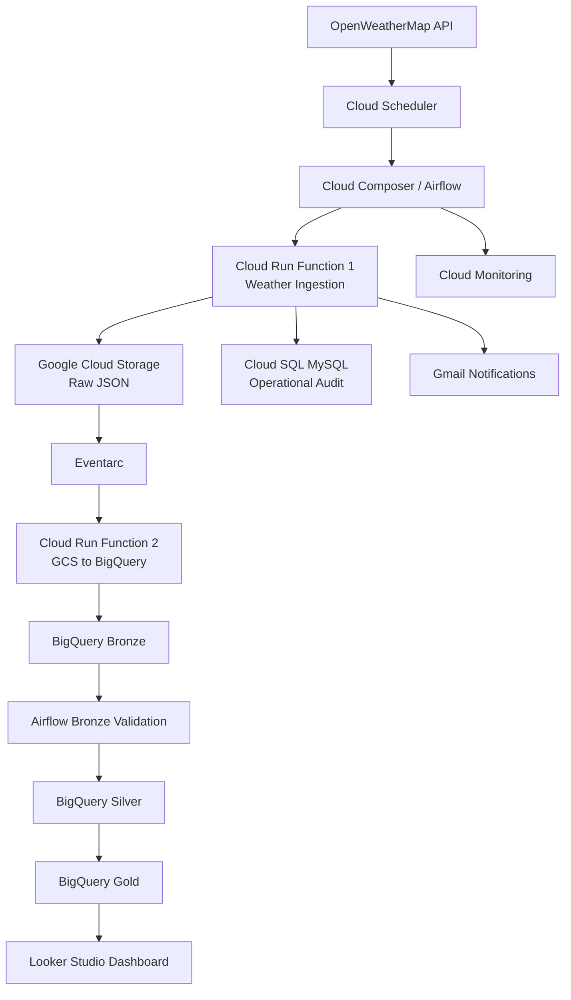
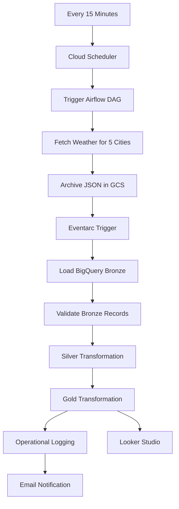
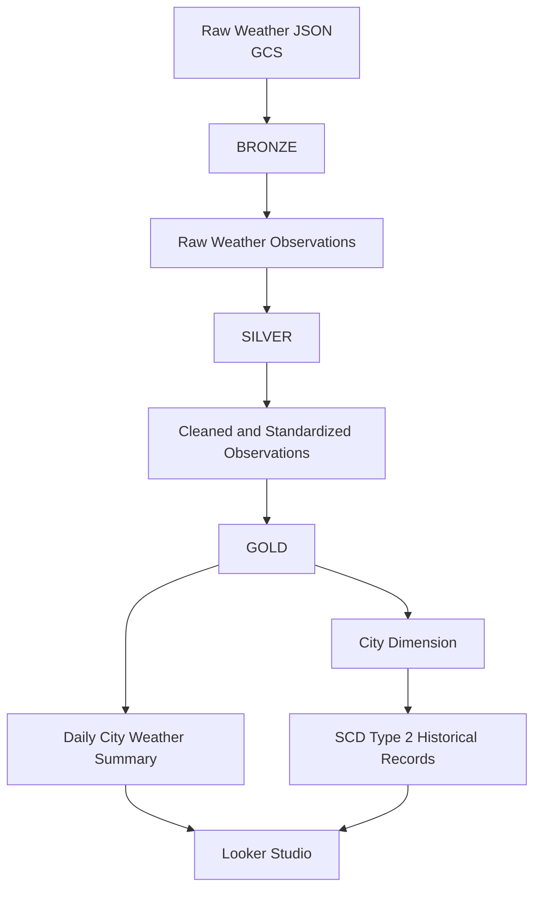
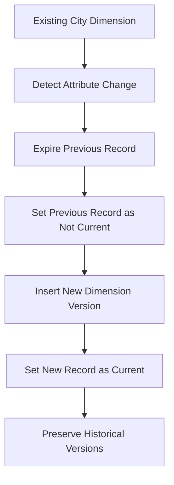

# 🌦️ AtmosData — India Weather Intelligence & Analytics Platform

<p align="center">
  <strong>End-to-End GCP Data Engineering Project</strong><br>
  Automated Weather Ingestion | Event-Driven Processing | BigQuery | Airflow | MySQL | Looker Studio
</p>

<p align="center">
  
  
  
  
  
</p>

---

## 📌 1. Project Overview

**AtmosData** is an end-to-end cloud-native data engineering platform built on Google Cloud Platform (GCP).

The platform collects weather observations from the OpenWeatherMap API for five major Indian cities, stores raw JSON data in Google Cloud Storage, processes the data through BigQuery Bronze, Silver and Gold layers, and presents analytical insights through a Looker Studio dashboard.

The pipeline uses Cloud Composer (Apache Airflow), Cloud Scheduler, Cloud Run Functions and Eventarc for automated orchestration and event-driven processing.

It also implements two UPSERT operations, Slowly Changing Dimension Type 2 (SCD Type 2), MySQL operational logging, Gmail notifications, Cloud Monitoring, Terraform infrastructure provisioning and GitHub Actions CI/CD.

### Cities Covered

| City | Country |
|---|---|
| Hyderabad | India |
| Bengaluru | India |
| Mumbai | India |
| Delhi | India |
| Chennai | India |

### Project Objectives

- Automate weather data collection every 15 minutes.
- Store raw API responses in Google Cloud Storage.
- Implement event-driven ingestion into BigQuery.
- Build Bronze, Silver and Gold warehouse layers.
- Implement two UPSERT operations using BigQuery MERGE.
- Implement SCD Type 2 historical dimension tracking.
- Orchestrate the pipeline using Apache Airflow.
- Maintain operational audit records in MySQL.
- Send pipeline success and failure notifications through Gmail.
- Monitor application errors through Cloud Monitoring.
- Visualize analytical data using Looker Studio.
- Automate infrastructure and application deployments through Terraform and GitHub Actions.

---

## 🏗️ 2. End-to-End Architecture

### Overall GCP Architecture



### Automated Pipeline Execution



Cloud Scheduler is the recurring trigger. The Airflow DAG uses `schedule=None` because Cloud Scheduler triggers it through the Composer API. This avoids duplicate 15-minute scheduling.

### BigQuery Medallion Architecture



---

## ⚙️ 3. Technology Stack

| Category | Technology |
|---|---|
| Cloud Platform | Google Cloud Platform |
| Programming | Python |
| Weather API | OpenWeatherMap |
| Infrastructure as Code | Terraform |
| CI/CD | GitHub Actions |
| Object Storage | Google Cloud Storage |
| Serverless Compute | Cloud Run Functions |
| Event Processing | Eventarc |
| Data Warehouse | BigQuery |
| Data Orchestration | Cloud Composer / Apache Airflow |
| Operational Database | Cloud SQL MySQL 8.4 |
| Scheduling | Cloud Scheduler |
| Notifications | Gmail SMTP |
| Monitoring | Cloud Monitoring |
| Visualization | Looker Studio |

---

## 📥 4. Bronze Layer — Raw Data Ingestion

The Bronze layer captures weather data from the API and retains the original source information.

### Processing Flow

1. Airflow invokes the weather ingestion Cloud Run Function.
2. The function fetches weather information for five cities.
3. Raw JSON responses are archived in GCS.
4. Eventarc detects newly finalized GCS objects.
5. The GCS-to-BigQuery function loads observations into Bronze.

**GCS Bucket:** `weatherpulse-raw-dev-802327721598`

**BigQuery Dataset:** `weather_bronze_dev`

### GCS Raw Bucket Evidence


### Bronze Table Evidence


---

## 🥈 5. Silver Layer — Data Transformation and UPSERT

The Silver layer contains cleaned and standardized weather observations.

The transformation uses BigQuery SQL and a MERGE-based UPSERT pattern.

### Silver UPSERT Logic

The UPSERT operation combines INSERT and UPDATE behavior:

- If a matching record exists, the existing record is updated.
- If no matching record exists, a new record is inserted.
- MERGE matching conditions determine the appropriate action.
- Incremental processing helps maintain the target table without unnecessarily inserting duplicate matching records.

**BigQuery Dataset:** `weather_silver_dev`

### Silver Transformation Evidence


### Silver UPSERT — Logic and Execution Evidence


---

## 🥇 6. Gold Layer — Analytical Data and UPSERT

The Gold layer contains business-ready analytical data used by the Looker Studio dashboard.

**BigQuery Dataset:** `weather_gold_dev`

**Main Table:** `daily_city_weather`

### Gold Table Structure

| Column | Description |
|---|---|
| weather_date | Weather observation date |
| city | City name |
| avg_temperature_c | Average temperature |
| min_temperature_c | Minimum temperature |
| max_temperature_c | Maximum temperature |
| avg_humidity_pct | Average humidity |
| observation_count | Number of observations |
| refreshed_at_utc | Last refresh timestamp |

### Gold UPSERT Logic

The Gold transformation performs a second UPSERT using BigQuery MERGE.

- Matches records using the target business key.
- Updates existing daily city summaries.
- Inserts new city/date combinations.
- Maintains the analytical summary table as new data arrives.

### Gold UPSERT — Logic and Execution Evidence


### Gold MERGE Execution Evidence


### Gold Data Verification


---

## 🔁 7. Slowly Changing Dimension Type 2 (SCD Type 2)

AtmosData implements SCD Type 2 to preserve historical changes in the city dimension rather than overwriting previous attribute values.

### SCD Type 2 Implementation

The implementation maintains:

- Historical versions of dimension records.
- Effective start dates.
- Effective end dates.
- A current-record indicator (`is_current`).
- Previous values for historical analysis.

When a tracked attribute changes, the previous version is retained and a new current version is created.

### SCD Type 2 Processing



### SCD Type 2 — Logic Evidence


### City Record Version Evidence


### Historical Version Verification


---

## ☁️ 8. Infrastructure as Code — Terraform

Terraform is used to provision and manage GCP infrastructure.

The infrastructure includes:

- GCP APIs and IAM permissions.
- Service accounts.
- GCS raw storage bucket.
- BigQuery datasets.
- Cloud Run Functions.
- Eventarc configuration.
- Cloud SQL MySQL.
- Cloud Composer.
- Cloud Scheduler.
- Cloud Monitoring resources.

### Terraform Deployment Evidence


### IAM Access and Approval Evidence


---

## 🚀 9. CI/CD — GitHub Actions

GitHub Actions automates infrastructure and application deployments.

### Terraform CD

The infrastructure workflow:

1. Initializes Terraform.
2. Validates Terraform configuration.
3. Generates a Terraform plan.
4. Checks for unintended resource deletions.
5. Requires approval before applying the saved plan.
6. Applies the approved infrastructure changes.

### Application CD

The application workflow:

1. Deploys the weather ingestion function.
2. Deploys the GCS-to-BigQuery function.
3. Configures Eventarc integration.
4. Uploads Airflow DAG files.
5. Uploads dependent SQL files to Composer.

### Application Deployment Evidence


---

## 🔄 10. Cloud Composer and Apache Airflow

Cloud Composer hosts the Airflow environment responsible for coordinating the data pipeline.

**DAG ID:** `atmosdata_weather_pipeline`

**Trigger Frequency:** Every 15 minutes through Cloud Scheduler.

### Airflow DAG Tasks

1. Invoke weather ingestion.
2. Validate Bronze records.
3. Execute Silver transformation.
4. Execute Gold transformation.

The ingestion function also performs MySQL audit logging and Gmail notification handling.

### Airflow Execution Evidence


---

## 🗄️ 11. MySQL Operational Database

Cloud SQL MySQL 8.4 is used as the operational database.

**Database:** `atmosdata_ops`

Operational tables:

| Table | Purpose |
|---|---|
| `city_master` | City master data |
| `error_log` | Application error tracking |
| `ingestion_audit` | Ingestion audit records |
| `pipeline_audit` | Pipeline execution tracking |

MySQL provides operational visibility and supports pipeline auditing and troubleshooting.

---

## 📧 12. Gmail Notifications

Gmail SMTP is integrated into the ingestion process.

Notifications support:

- Successful ingestion.
- Partial ingestion.
- Failed ingestion.

Credentials are stored in Secret Manager rather than hardcoded in application source code.

### Email Notification Evidence


---

## 📊 13. Looker Studio — India Weather Intelligence Dashboard

The Looker Studio dashboard connects to the BigQuery Gold layer.

### Dashboard KPIs and Visualizations

- Average Temperature.
- Average Humidity.
- Total Cities.
- Latest Data Refresh.
- Daily Average Temperature by City.
- Minimum vs Maximum Temperature by City.
- Average Humidity by City.
- Daily Weather Observation Count.
- Date range filter.
- City dropdown filter.

### Dashboard Preview


---

## 🚨 14. Monitoring and Alerting

Cloud Monitoring is configured with the alert policy:

`AtmosData - Cloud Run HTTP 5xx Errors`

The alert policy monitors Cloud Run HTTP 5xx errors and helps identify application failures.

---

## 📁 15. Repository Structure

```text
AtmosData/
│
├── .github/
│   └── workflows/
│       ├── terraform-cd.yml
│       └── application-cd.yml
│
├── airflow/
│   └── dags/
│       ├── atmosdata_weather_pipeline.py
│       └── sql/
│           ├── silver/
│           │   └── transform_weather.sql
│           └── gold/
│               └── build_daily_city_summary.sql
│
├── cloud_run_functions/
│   ├── weather_ingestion/
│   ├── gcs_to_bigquery/
│   └── email_notification/
│
├── mysql/
│   └── tables/
│       └── 001_operational_tables.sql
│
├── sql/
│   ├── bronze/
│   ├── silver/
│   └── gold/
│
├── terraform/
│   ├── main.tf
│   ├── variables.tf
│   └── outputs.tf
│
├── docs/
│   └── outputs/
│       ├── application cd workflow.png
│       ├── application cd.png
│       ├── approval Acess.png
│       ├── city record versions.png
│       ├── email notification.png
│       ├── gcs bucket raw.png
│       ├── gold layer count verify.png
│       ├── gold merge 2.png
│       ├── gold merge.png
│       ├── Looker dashboard.png
│       ├── Pipeline Runs.png
│       ├── real logic apply.png
│       ├── SCD type 2.png
│       ├── silver layer 2.png
│       ├── silver layer transformation.png
│       ├── table bronze.png
│       ├── TerraformGitHub Actions deployment success.png
│       ├── UPSERT Logic - silver.png
│       ├── UPSERT Logic gold.png
│       └── verfication historical versions.png
│
└── README.md
```

---

## 🔐 16. Security and Configuration

- Secret Manager stores sensitive API and database credentials.
- Dedicated service accounts are used for cloud workloads.
- IAM permissions are configured for individual workloads.
- Terraform state is stored in a remote GCS bucket.
- GitHub Actions uses controlled deployment permissions.
- Terraform CD includes a safeguard against unintended resource deletions.

---

## 💰 17. Cost Management

Some GCP resources incur charges even when the pipeline is idle.

Cloud Composer is particularly important to monitor because its environment continues to incur costs while running.

For temporary development environments, Composer can be removed through a carefully reviewed Terraform deployment and recreated later. Shared resources such as GCS, BigQuery datasets and Cloud SQL must be preserved.

---

## 🎯 18. Project Outcomes

AtmosData demonstrates practical implementation of:

- End-to-end GCP data engineering.
- API-based weather ingestion.
- Event-driven data processing.
- GCS and BigQuery integration.
- Bronze, Silver and Gold data warehouse architecture.
- Two BigQuery UPSERT operations.
- SCD Type 2 historical dimension management.
- Python-based serverless functions.
- Cloud Composer and Apache Airflow orchestration.
- Cloud Scheduler automation.
- MySQL operational auditing.
- Gmail notifications.
- Terraform infrastructure provisioning.
- GitHub Actions CI/CD.
- Cloud Monitoring and alerting.
- Looker Studio dashboard development.

---

## 👨‍💻 Author

**Pavan Kumar Gummadi**

GCP Data Engineering | BigQuery | Python | SQL | Terraform | Apache Airflow | Cloud Composer

GitHub: [cloudwithpavan](https://github.com/cloudwithpavan)

Project Repository: [AtmosData](https://github.com/cloudwithpavan/AtmosData)


