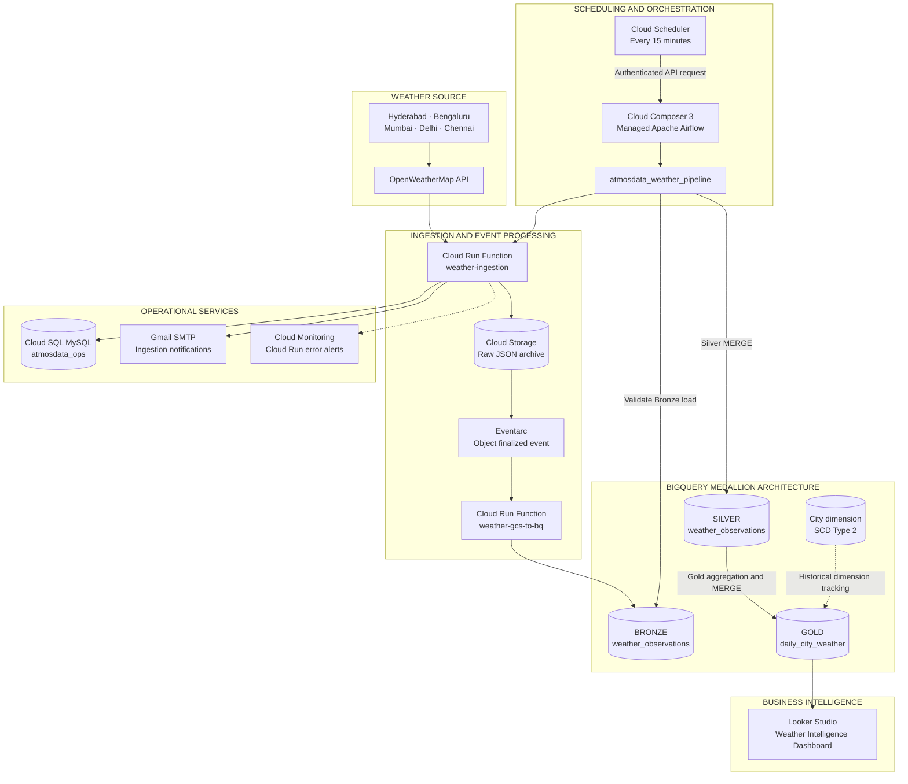
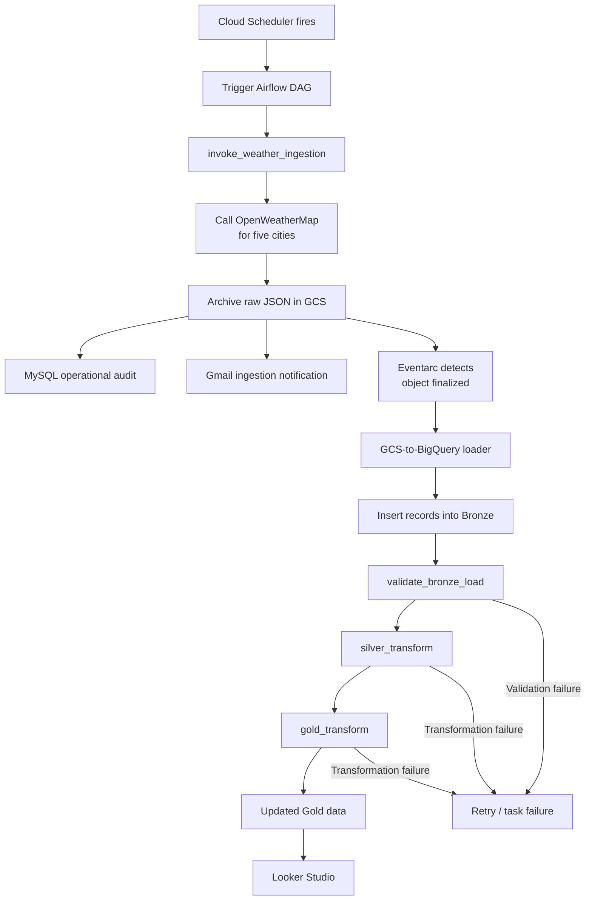
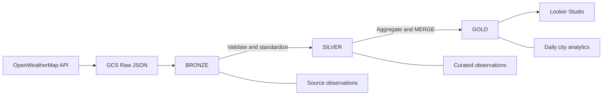
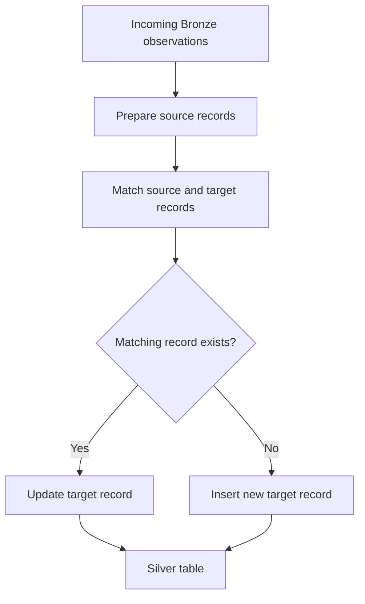
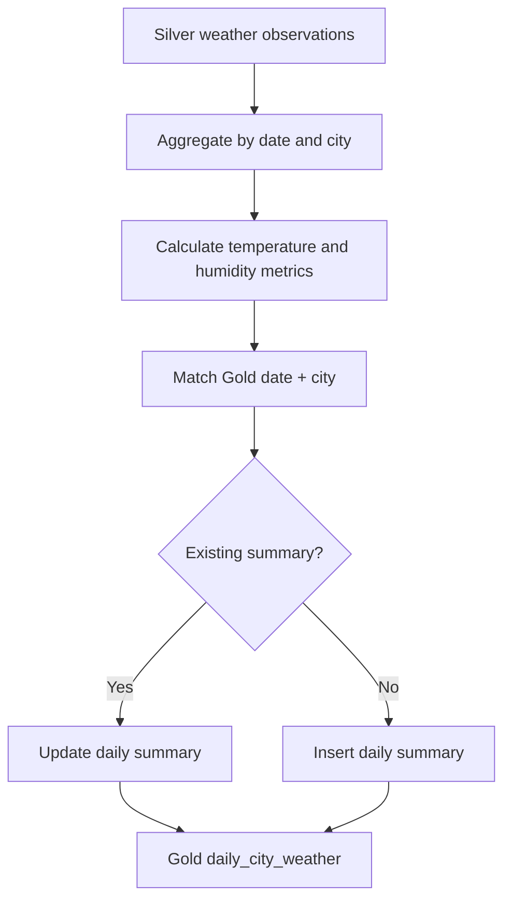
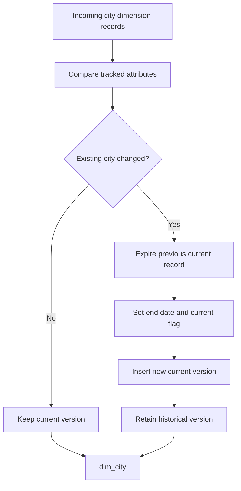
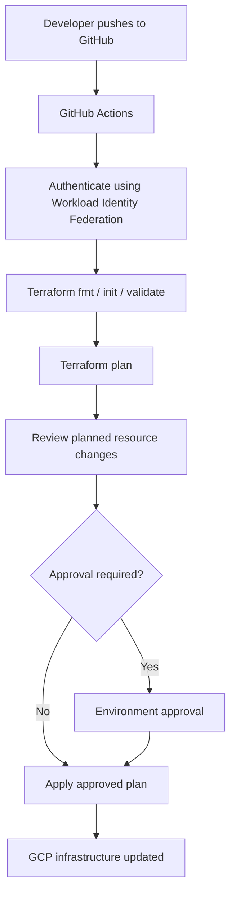

<h1 align="center">
    🌦️ AtmosData</h1>

<h1 align="center">
    Real-Time Weather Data Intelligence & Analytics Platform


<p align="center">
  <strong>An end-to-end Google Cloud data engineering project</strong><br/>
  Automated ingestion · Event-driven processing · Medallion architecture · Apache Airflow · Terraform · BigQuery · MySQL · Looker Studio
</p>

<p align="center">
  <a href="https://cloud.google.com/"></a>
  <a href="https://www.python.org/"></a>
  <a href="https://www.terraform.io/"></a>
  <a href="https://airflow.apache.org/"></a>
  <a href="https://cloud.google.com/bigquery"></a>
  <a href="https://www.mysql.com/"></a>
  <a href="https://lookerstudio.google.com/"></a>
</p>

<p align="center">
  
  
  
  
</p>

---

## 📌 Project at a glance

| Project characteristic | Implementation |
|:---|:---|
| Cloud platform | Google Cloud Platform |
| GCP project | `my-project-77-511616` |
| Region | `asia-south1` |
| Weather source | OpenWeatherMap API |
| Coverage | 5 Indian cities |
| Collection interval | Every 15 minutes when scheduled execution is enabled |
| Raw data storage | Google Cloud Storage |
| Data warehouse | BigQuery |
| Data architecture | Bronze → Silver → Gold |
| Orchestration | Cloud Composer 3 / Apache Airflow |
| Operational database | Cloud SQL for MySQL 8.4 |
| Infrastructure as Code | Terraform |
| CI/CD | GitHub Actions + Workload Identity Federation |
| Event processing | Eventarc |
| Notifications | Gmail SMTP |
| Monitoring | Cloud Monitoring |
| Business intelligence | Looker Studio |

### 🌍 Cities covered

Hyderabad · Bengaluru · Mumbai · Delhi · Chennai

### 🎯 Project objectives

AtmosData demonstrates how to build a cloud-native data engineering platform that:

- Collects weather data from an external API.
- Archives original JSON responses in Cloud Storage.
- Uses event-driven processing to load data into BigQuery.
- Transforms data through Bronze, Silver and Gold layers.
- Implements two separate MERGE-based UPSERT processes.
- Maintains historical city dimension records using SCD Type 2.
- Stores operational audit information in MySQL.
- Sends ingestion outcome notifications through Gmail.
- Provisions infrastructure through Terraform.
- Automates deployments using GitHub Actions.
- Exposes analytical results through Looker Studio.

---

## 📚 Table of contents

1. [Project overview](#-project-overview)
2. [End-to-end architecture](#-end-to-end-architecture)
3. [Pipeline execution](#-automated-pipeline-execution)
4. [Weather ingestion and raw storage](#-weather-ingestion--raw-storage)
5. [BigQuery Medallion architecture](#-bigquery-medallion-architecture)
6. [SCD Type 2 historical dimension](#-scd-type-2-historical-city-dimension)
7. [MySQL operational database](#-mysql-operational-database)
8. [Gmail notifications](#-gmail-notifications)
9. [Terraform infrastructure](#-terraform-infrastructure-as-code)
10. [GitHub Actions CI/CD](#-github-actions-cicd)
11. [Monitoring and alerting](#-monitoring--alerting)
12. [Looker Studio dashboard](#-looker-studio-dashboard)
13. [Repository structure](#-repository-structure)
14. [Security and cost management](#-security--cost-management)
15. [Project outcomes](#-project-outcomes)
16. [Author](#-author)

---

## 🚀 1. Project overview

AtmosData is an end-to-end weather data engineering platform built on Google Cloud Platform.

It collects weather observations from OpenWeatherMap for five Indian cities, stores the original API responses in Google Cloud Storage, processes the data through a BigQuery Medallion architecture, and presents analytical insights through Looker Studio.

The architecture combines scheduled orchestration, event-driven ingestion, SQL-based transformations, operational auditing and automated infrastructure deployment.

### Core engineering capabilities

| Capability | Technology | Implementation |
|:---|:---|:---|
| Weather collection | Python + OpenWeatherMap | API-based ingestion |
| Raw archival | Cloud Storage | JSON object storage |
| Event detection | Eventarc | GCS object-finalized events |
| Data loading | Cloud Run Functions | GCS-to-BigQuery |
| Orchestration | Cloud Composer / Airflow | DAG-based execution |
| Data warehouse | BigQuery | Bronze, Silver and Gold |
| Data integration | BigQuery SQL | MERGE-based UPSERT |
| Historical tracking | BigQuery SQL | SCD Type 2 |
| Operational tracking | Cloud SQL MySQL | Audit and error records |
| Notifications | Gmail SMTP | Ingestion outcome emails |
| Infrastructure | Terraform | Reproducible GCP resources |
| CI/CD | GitHub Actions | Automated deployment |
| Reporting | Looker Studio | Weather analytics dashboard |

---

## 🏗️ 2. End-to-end architecture

The following diagram represents the complete logical architecture. Composer and Scheduler are optional runtime components that can be provisioned when scheduled Airflow execution is required.



### Architecture responsibilities

| GCP component | Responsibility |
|:---|:---|
| Cloud Scheduler | Triggers the Airflow DAG on a 15-minute schedule |
| Cloud Composer | Hosts managed Apache Airflow |
| Airflow DAG | Coordinates ingestion, validation and transformations |
| Cloud Run Function 1 | Calls OpenWeatherMap and writes raw JSON |
| Cloud Storage | Maintains original weather API responses |
| Eventarc | Detects newly finalized GCS objects |
| Cloud Run Function 2 | Loads raw observations into BigQuery Bronze |
| BigQuery | Stores and transforms analytical data |
| Cloud SQL MySQL | Stores operational audit and error information |
| Gmail SMTP | Sends ingestion outcome notifications |
| Cloud Monitoring | Detects configured Cloud Run HTTP 5xx errors |
| Looker Studio | Visualizes Gold-layer analytical data |

---

## ⏱️ 3. Automated pipeline execution

### Scheduling configuration

When the orchestration layer is enabled, Cloud Scheduler triggers the Airflow DAG through the Composer API.

| Setting | Configuration |
|:---|:---|
| Scheduler job | `atmosdata-weather-pipeline-15min` |
| Schedule | `*/15 * * * *` |
| Time zone | `Asia/Kolkata` |
| Target | Composer `executeAirflowCommand` API |
| DAG ID | `atmosdata_weather_pipeline` |
| DAG schedule | `None` — externally triggered |

The DAG is externally triggered, avoiding two independent 15-minute schedules.

### Pipeline execution flow



> **Important execution detail:** Eventarc loads Bronze asynchronously. Airflow validates that the corresponding GCS object has reached Bronze before continuing to Silver and Gold. The validation task uses retries to account for the asynchronous event-driven load.

### Airflow DAG tasks

DAG ID: `atmosdata_weather_pipeline`

| Task | Responsibility |
|:---|:---|
| `invoke_weather_ingestion` | Invokes the weather ingestion function |
| `validate_bronze_load` | Checks that Bronze loading has completed |
| `silver_transform` | Executes the Silver transformation |
| `gold_transform` | Executes the Gold aggregation and MERGE |

The ingestion function handles MySQL audit and Gmail notification integration. Eventarc independently handles the GCS object-finalization event and Bronze loading.

### Airflow execution evidence


---

## 🌦️ 4. Weather ingestion & raw storage

OpenWeatherMap is the external weather data source.

The ingestion function retrieves observations for:

- Hyderabad
- Bengaluru
- Mumbai
- Delhi
- Chennai

The original API response is archived in GCS as JSON. This preserves source-level data for reprocessing and investigation.

### GCS raw bucket

`weatherpulse-raw-dev-802327721598`

**Storage configuration**

- Uniform Bucket-Level Access enabled.
- Public access prevention enabled.
- Lifecycle transition from Standard to Coldline after 365 days.
- Original JSON weather responses retained in the raw archive.

### Raw storage evidence


### Ingestion characteristics

- Five-city weather collection.
- 15-minute scheduled execution when Scheduler is enabled.
- Original JSON archival in GCS.
- Successful and partial ingestion status handling.
- MySQL operational audit integration.
- Gmail ingestion outcome notifications.

---

## 🥉 5. BigQuery Medallion architecture

AtmosData uses three logical data layers. Each layer has a separate data engineering responsibility.



### 5.1 Bronze layer — source observations

**Dataset:** `weather_bronze_dev`

**Table:** `weather_observations`

The Bronze layer receives weather records from the GCS-to-BigQuery Cloud Run function after Eventarc detects a finalized raw object.

Responsibilities:

- Preserve source-level weather observations.
- Maintain ingestion metadata and source object references.
- Support downstream validation and transformation.
- Provide a reliable starting point for analytical processing.

**Table configuration**

- Partitioned by `loaded_at_utc`.
- Clustered by `city`.

#### Bronze table evidence


### 5.2 Silver layer — cleaned and upserted observations

**Dataset:** `weather_silver_dev`

**Table:** `weather_observations`

The Silver transformation converts Bronze observations into the curated weather observation table.

Responsibilities:

- Standardize source records.
- Apply the defined transformation logic.
- Maintain target records using a `MERGE`-based UPSERT.
- Avoid unnecessary duplicate inserts when records are reprocessed.

**Transformation SQL**

`sql/silver/transform_weather.sql`

#### Silver transformation evidence


#### Silver output


#### UPSERT operation 1 — Silver

The Silver UPSERT maintains curated observation records.



**Silver UPSERT implementation evidence**


### 5.3 Gold layer — analytical data

**Dataset:** `weather_gold_dev`

**Table:** `daily_city_weather`

The Gold layer produces daily city-level weather metrics for reporting and analysis.

| Column | Description |
|:---|:---|
| `weather_date` | Weather observation date |
| `city` | City name |
| `avg_temperature_c` | Average temperature |
| `min_temperature_c` | Minimum temperature |
| `max_temperature_c` | Maximum temperature |
| `avg_humidity_pct` | Average humidity |
| `observation_count` | Number of observations |
| `refreshed_at_utc` | Gold transformation refresh timestamp |

**Transformation SQL**

`sql/gold/build_daily_city_summary.sql`

#### UPSERT operation 2 — Gold

The Gold UPSERT maintains daily city summaries. It updates an existing date-and-city result or inserts a new result when no matching target record exists.



**Gold UPSERT implementation evidence**


#### Gold MERGE execution evidence


#### Gold output verification


---

## 🕒 6. SCD Type 2 — historical city dimension

SCD Type 2 is implemented separately from the Silver and Gold weather UPSERT operations.

**Dimension:** `dim_city`

The objective is to preserve historical versions of city dimension records when tracked attributes change.

### SCD Type 2 processing



### Implementation steps

1. Identify the city business key.
2. Compare tracked attributes.
3. If a tracked attribute changes, expire the previous current record.
4. Insert a new current version.
5. Retain the previous version for historical analysis.

The dimension preserves current and historical records instead of overwriting all previous values.

**SCD Type 2 SQL**

`sql/gold/scd_type2_city_update.sql`

### SCD Type 2 implementation evidence


### City record versions


### Historical version verification


### Difference between UPSERT and SCD Type 2

| Logic | Purpose | Behaviour |
|:---|:---|:---|
| Silver UPSERT | Maintain curated observations | Update matched records or insert new records |
| Gold UPSERT | Maintain daily analytical summaries | Update matched date-city summaries or insert new summaries |
| SCD Type 2 | Preserve dimension history | Expire old versions and insert new current versions |

These are three distinct data-management operations, not interchangeable transformations.

---

## 🗄️ 7. MySQL operational database

AtmosData uses Cloud SQL for MySQL 8.4 as its operational database.

| Setting | Configuration |
|:---|:---|
| Instance | `atmosdata-mysql-dev` |
| Database | `atmosdata_ops` |
| Application user | `atmosdata_app` |
| Engine | MySQL 8.4 |

### Operational schema

| Table | Purpose |
|:---|:---|
| `city_master` | City reference data |
| `ingestion_audit` | Ingestion execution records |
| `pipeline_audit` | Pipeline execution information |
| `error_log` | Error and failure records |

The weather ingestion function writes operational audit information to MySQL. This separates operational tracking from the BigQuery analytical warehouse.

---

## 📧 8. Gmail notifications

Gmail SMTP is used for ingestion outcome notifications.

The integration supports:

- Successful ingestion notifications.
- Partial-success notifications.
- Failure notifications.

**Source directory**

`cloud_run_functions/email_notification/`

The ingestion function retrieves Gmail credentials from Secret Manager instead of storing credentials in source code.

### Notification evidence


---

## ⚙️ 9. Terraform infrastructure as code

Terraform manages the GCP infrastructure required by AtmosData.

### Infrastructure managed through Terraform

- Cloud Storage bucket and lifecycle configuration.
- BigQuery datasets.
- Cloud Run service accounts and IAM permissions.
- Eventarc configuration.
- Secret Manager resources and access permissions.
- Cloud SQL resources.
- Cloud Composer environment.
- Cloud Scheduler job.
- Cloud Monitoring alert policy.
- Required service APIs and IAM bindings.

### Remote Terraform state

| Setting | Value |
|:---|:---|
| State bucket | `atmosdata-tfstate-dev-802327721598` |
| Region | `asia-south1` |
| State prefix | `terraform/state` |

Terraform state is stored remotely in GCS rather than relying on a developer's local state file.

### Terraform deployment workflow



### Terraform deployment evidence


---

## 🔄 10. GitHub Actions CI/CD

GitHub Actions automates application and infrastructure deployment.

### Application deployment

The application deployment workflow handles:

- Cloud Run function deployment.
- Airflow DAG deployment.
- Upload of Airflow SQL dependencies to the Composer DAG bucket.

### Infrastructure deployment

The Terraform workflows handle:

- Terraform formatting and validation.
- Infrastructure planning.
- Deployment approval.
- Terraform application.

### Authentication

GitHub Actions uses **Workload Identity Federation (WIF)** to authenticate to Google Cloud without storing long-lived service-account JSON keys in GitHub.

### Application CD workflow evidence


### Application deployment execution


---

## 📊 11. Monitoring & alerting

Cloud Monitoring is configured with an alert policy for Cloud Run HTTP 5xx errors.

The purpose is to detect application-level server errors from deployed Cloud Run services.

Monitoring complements other operational visibility mechanisms:

| Monitoring layer | Responsibility |
|:---|:---|
| Airflow | DAG and task execution status |
| MySQL | Operational audit and error records |
| Cloud Monitoring | Cloud Run service error alerting |

These mechanisms provide complementary views of application and pipeline health.

---

## 📈 12. Looker Studio dashboard

The Gold table `weather_gold_dev.daily_city_weather` is the reporting source for Looker Studio.

The dashboard provides a consolidated view of weather conditions across the five configured cities.

### Dashboard components

| Component | Metric |
|:---|:---|
| Average Temperature | Average of `avg_temperature_c` |
| Average Humidity | Average of `avg_humidity_pct` |
| Total Cities | Distinct city count |
| Latest Data Refresh | Maximum `refreshed_at_utc` |
| Daily Average Temperature by City | Daily temperature trend |
| Minimum vs Maximum Temperature | City-level temperature comparison |
| Average Humidity by City | City-level humidity comparison |
| Daily Observation Count | Total observations by date |

The dashboard includes date-range and city filters.

The report is connected to BigQuery Gold data. Its data freshness setting is configured to 15 minutes. Actual visible changes depend on new data being processed and the report refreshing its data.

### AtmosData — India Weather Intelligence Dashboard


---

## 📁 13. Repository structure

```text
AtmosData/
│
├── .github/
│   └── workflows/
│       ├── application-ci.yml
│       ├── application-cd.yml
│       ├── terraform-backend-bootstrap.yml
│       ├── terraform-ci.yml
│       └── terraform-cd.yml
│
├── airflow/
│   └── dags/
│       ├── atmosdata_weather_pipeline.py
│       └── sql/
│           ├── silver/
│           │   └── transform_weather.sql
│           └── gold/
│               └── build_daily_city_summary.sql
│
├── cloud_run_functions/
│   ├── email_notification/
│   ├── gcs_to_bigquery/
│   └── weather_ingestion/
│
├── mysql/
│   └── tables/
│       └── 001_operational_tables.sql
│
├── sql/
│   ├── bronze/
│   ├── silver/
│   └── gold/
│       └── scd_type2_city_update.sql
│
├── terraform/
│   ├── main.tf
│   ├── variables.tf
│   ├── outputs.tf
│   └── backend.tf
│
├── docs/
│   └── outputs/
│       ├── application cd workflow.png
│       ├── application cd.png
│       ├── approval Acess.png
│       ├── city record versions.png
│       ├── email notification.png
│       ├── gcs bucket raw.png
│       ├── gold layer count verify.png
│       ├── gold merge 2.png
│       ├── gold merge.png
│       ├── looker dashboard.png
│       ├── Pipeline Runs.png
│       ├── real logic apply.png
│       ├── SCD type 2.png
│       ├── silver layer 2.png
│       ├── silver layer transformation.png
│       ├── table bronze.png
│       ├── TerraformGitHub Actions deployment success.png
│       ├── UPSERT Logic - silver.png
│       ├── UPSERT Logic gold.png
│       └── verfication historical versions.png
│
├── README.md
└── .gitignore
```

---

## 🔐 14. Security & cost management

### Security practices

- GitHub Actions authenticates using Workload Identity Federation.
- Application credentials are stored in Google Secret Manager.
- Cloud Storage uses Uniform Bucket-Level Access.
- Public access prevention is enabled on the raw bucket.
- IAM permissions are assigned to the relevant service accounts.
- MySQL passwords and Gmail credentials are not committed to Git.
- Terraform state is stored in a dedicated GCS bucket.

### Cost management: on-demand Composer

Cloud Composer and Cloud SQL are managed GCP services that can incur ongoing charges.

To control Composer costs, AtmosData uses the Terraform variable:

`enable_composer`

| Configuration | Result |
|:---|:---|
| `enable_composer = true` | Creates Composer, Airflow runtime, Cloud Scheduler and related IAM resources |
| `enable_composer = false` | Removes Composer, Cloud Scheduler and their dedicated IAM/service-account resources |

The persistent data and application layer is retained when Composer is disabled.

### Restarting the Airflow environment

When scheduled pipeline execution is required again:

1. Set `enable_composer=true` in the Terraform CD workflow.
2. Keep `enable_cloud_sql=true`.
3. Commit and push the workflow change.
4. Review the Terraform plan and approve the deployment.
5. Wait until Composer reaches `RUNNING`.
6. Allow Application CD to upload the DAG and SQL dependencies.
7. Verify the DAG is present and unpaused.
8. Trigger a manual DAG run and verify successful execution.
9. Confirm Cloud Scheduler triggers the DAG every 15 minutes.

When testing is complete, set `enable_composer=false` and deploy the Terraform teardown through GitHub Actions.

**Important:** Composer and Scheduler are currently treated as on-demand components. Their source configuration remains in GitHub and can be recreated through Terraform. The existing GCS, BigQuery, Cloud Run and MySQL resources are not intended to be deleted by this Composer-only teardown.

Other GCP services, including Cloud SQL, can still incur charges while Composer is disabled.

---

## 🏆 15. Project outcomes

AtmosData brings together the major stages of a cloud data engineering workflow.

| Engineering area | Demonstrated capability |
|:---|:---|
| Data ingestion | Automated five-city weather collection |
| Raw storage | JSON archival in GCS |
| Event-driven processing | Eventarc-triggered loading |
| Data warehouse | BigQuery Medallion architecture |
| Data transformation | SQL-based Silver and Gold MERGE operations |
| Historical data | SCD Type 2 dimension tracking |
| Orchestration | Apache Airflow DAGs |
| Operational database | MySQL audit and error records |
| Notifications | Gmail SMTP integration |
| Infrastructure | Terraform-managed GCP resources |
| CI/CD | GitHub Actions and WIF |
| Monitoring | Cloud Monitoring alert policy |
| Analytics | Looker Studio dashboard |

### Key engineering concepts demonstrated

- API-based ingestion.
- Event-driven architecture.
- Cloud-native serverless processing.
- GCS raw data archival.
- BigQuery partitioning and clustering.
- Medallion data architecture.
- SQL MERGE and UPSERT patterns.
- Slowly Changing Dimension Type 2.
- Workflow orchestration with Airflow.
- Operational database design.
- Infrastructure as Code.
- CI/CD with federated authentication.
- Cost-aware cloud resource lifecycle management.
- Business intelligence and analytics.

---

## 👨‍💻 16. Author

### Pavan Kumar Gummadi

**GCP Data Engineering | BigQuery | Python | SQL | Terraform | Apache Airflow | Cloud Composer**

<p align="center">
  <a href="https://github.com/cloudwithpavan">
    
  </a>
  <a href="https://github.com/cloudwithpavan/AtmosData">
    
  </a>
</p>

**Repository:** [github.com/cloudwithpavan/AtmosData](https://github.com/cloudwithpavan/AtmosData)

---

<p align="center">
  <strong>🌦️ AtmosData</strong><br/>
  <em>From OpenWeatherMap API ingestion to actionable weather intelligence on Google Cloud.</em>
</p>

<p align="center">
  Built with Python · SQL · Google Cloud · Terraform · Apache Airflow
</p>
